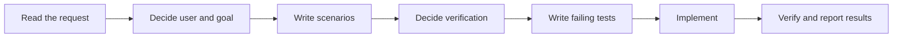

# BDD

Before implementing, decide who must be able to do what for the work to count as done. The scenario is the source of truth for acceptance criteria, not a description of the implementation.

## Steps



1. From the request, read the user, what they want to do, and why. Ask a human only if the interpretation changes the outcome.
2. Write scenarios into the Issue's acceptance criteria in Given/When/Then form. If an existing scenario changes, rewrite it. Search existing criteria for the behavior you replace, not only the part the Issue names: a change for one command often alters output another rule or schema owns.
3. Decide how each scenario is verified. Do not write how it is implemented.
4. Write tests per the `testing` skill, with the Issue number next to the test in a comment (this repo's convention: `// <what> (#<issue>)`).
5. Implement. If behavior changes midway, fix the scenario first.

## Scenarios shape the code

Scenarios are the product's main record of what users can do.

| Scenario tells | Use it to |
|---|---|
| Which inputs users can produce | Narrow types so impossible inputs cannot be expressed; do not write tests for values the types already exclude |
| What the user sees when something fails | Decide the error each function returns and the diagnostic it prints, before writing the unit tests |
| What must stay fast | Add the measured performance check to the verification items |

## Scenario format

```markdown
## jaio check はリンク切れを行番号付きで報告する

- 利用者: 自分のリポジトリを解析する開発者
- 目的: 壊れた相対リンクを修正前に見つける

​```gherkin
Given docs/guide.md が存在しない docs/missing.md へのリンクを含む
When jaio check . を実行する
Then relation/broken-link の診断が docs/guide.md のリンク行で報告される
And 終了コードは診断の重大度に従う
​```

- 自動: crates/jaio-rules/tests/rules.rs
- 手動: なし(JSON 出力は schema テストで検証)
```

| Item | Rule |
|---|---|
| Heading | What the user can do or what happens. Not a feature or command name |
| Given | Precondition state. No lists of steps |
| When | One user action or external event |
| Then | Result visible to the user (output, exit code, JSON field). No internal function names |
| Verification | One or more of `- 自動: <test path>` or `- 手動: <steps and reason>`. Put each test path on its own line |

The `自動` test must name the Issue number in a comment.

## What to write

| Kind | Question | Example |
|---|---|---|
| Main flow | Is the goal achieved | A duplicate section pair is reported with both locations |
| Failure | What happens to the user on failure | An unreadable file is reported as an operational error, not a panic |
| Boundary | Correct at the edge of expectations | A document at the minimum analyzable size |
| Undo | Do stopped or deleted things stay so | An excluded path produces no diagnostics and no error |
| Misoperation | Are unintended results prevented | An empty `jaio.toml` section keeps defaults |

## Criteria

- If behavior is the same after an implementation change, the scenario does not change.
- Do not write scenarios for things users do not care about. Guard internal branches with unit tests.
- Write what must be visible for it to be correct, following the [writing](../writing/SKILL.md) skill; "works correctly" or "reports appropriately" is not a criterion.
- If automation is impossible, state the reason in the manual line. Example: it needs a real dictionary binary.

## Done when

- The changed behavior has a scenario in the Issue.
- Every scenario has a verification; run the checks in the [testing scope](../testing/SKILL.md#check-scope).
- Do the manual verifications for real, and report separately what was and was not done.
