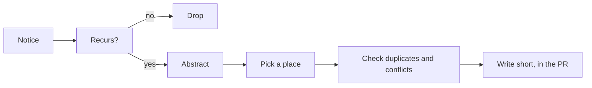

# Harness learning

Operation teaches what the harness lacks. Return what will recur, abstractly, so the next agent does not repeat the failure.

## Notice

Ask at each milestone: what failed or surprised, what a human corrected, what I did twice. Record only what a future agent, not knowing it, would likely repeat.

## Abstract

Write "in what situation, what tends to happen, how to judge". Leave room for user instructions and philosophy; do not fix rules harder than the evidence.

| Do not write | Instead |
|---|---|
| Issue numbers, commits, dates, file lists | The situation and the judgment |
| A story of what happened | The trap that recurs |
| An absolute rule from one case | A default with its reason and when to break it |

## Pick a place

| Learning is | Place |
|---|---|
| Applies to every area, one line | `AGENTS.md` (repo root) |
| A repeated procedure | A skill; one concern per skill, split a large one |
| Facts about a tool or area | `.oboro/knowledge/<topic>.md` with version and evidence |
| Decidable by a machine | A check in `.oboro/checks/` with its test |
| Product fact or decision | `docs/`, not the harness |

## Check and write

1. Search the harness for the same or a conflicting rule; merge or fix it rather than add.
2. Keep one fact in one place; link elsewhere.
3. Follow the [writing](../writing/SKILL.md) and [writing-en](../writing-en/SKILL.md) skills: short, concrete, one fact in one place.
4. Ship it in the normal PR and gate. The reviewer applies the `harness-review` skill; you do not review your own harness change. No per-addition human approval.
5. Use an `oboro:confirm` Issue only for product direction, human philosophy, or loosening an existing rule; proceed on the decision role's proposal.

## Prune

Remove what is stale, overlapping, or too specific. The inventory role does this periodically. Deleting a rule needs evidence it no longer applies.

## Report

Every completion report has a "harness learnings" field: what was returned and where, or "none".
